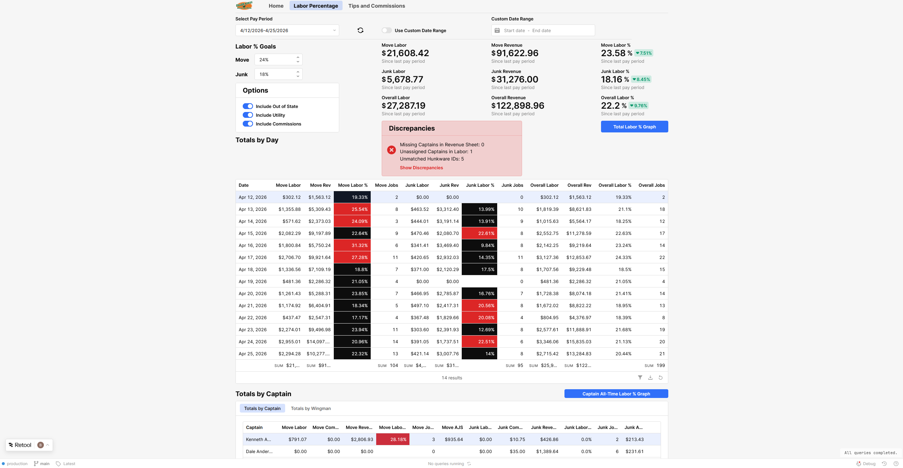
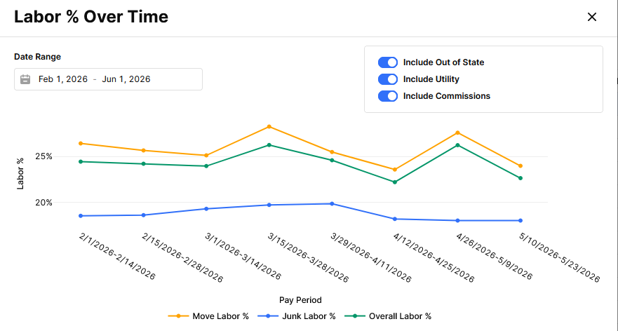
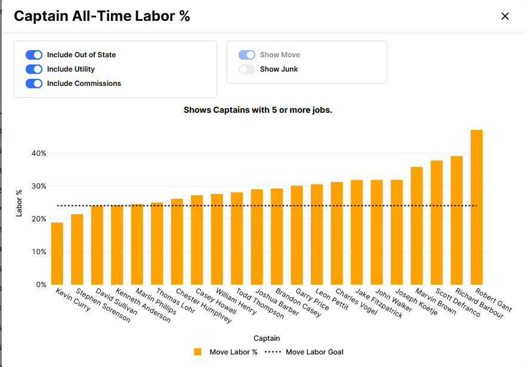
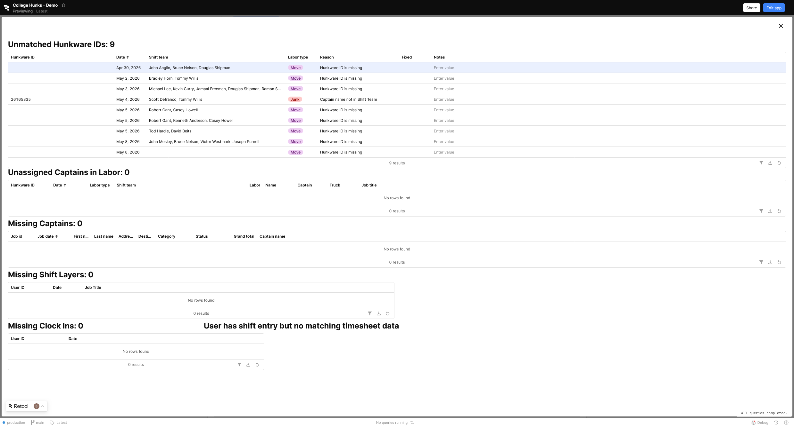
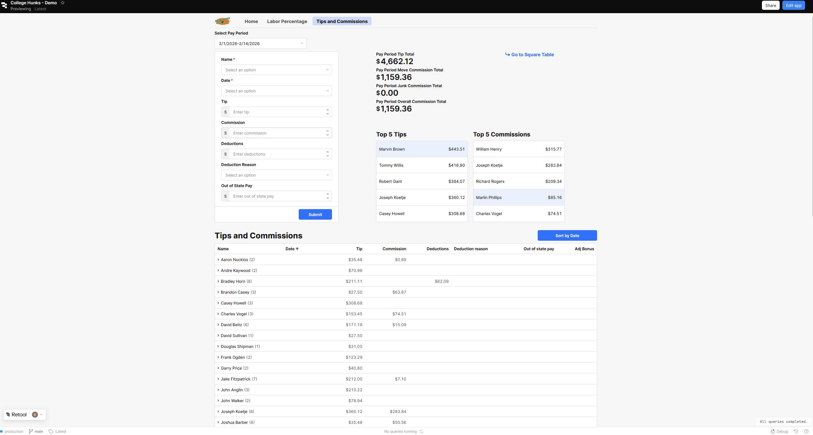

# Labor Analytics & Payroll Tool

An internal tool I built as the sole developer for a College Hunks Hauling Junk & Moving franchise location. It replaced spreadsheet-based labor and payroll tracking and saves an estimated 2–3 hours of manual work per day for the franchise owner and shift scheduler.

> **Note:** The production app is private. These screenshots come from a demo copy I built that runs on anonymized data, so all names and figures shown are anonymized.

## The problem

Labor and revenue data lived in two separate systems. Tracking labor cost as a percentage of revenue, checking crew performance, and preparing payroll meant pulling exports and reconciling them by hand in spreadsheets every day.

## How it works

```
Labor API ─┐
           ├─► Supabase Edge Functions ─► PostgreSQL ─► Retool app (JavaScript logic)
Revenue API┘     (fetch + normalize)       (schema)      (reports, checks, charts)
```

- **Data pipeline:** Supabase Edge Functions pull from the company's labor and revenue APIs and normalize the results into a consistent PostgreSQL schema.
- **Calculation logic:** JavaScript in Retool computes labor as a percentage of revenue by day, pay period, crew lead and crew member, compares against the previous pay period, and flags results that miss adjustable targets for move and junk-removal jobs.
- **Data-integrity checks:** Records missing or mismatched between the labor and revenue systems are flagged automatically before payroll is finalized, including job IDs that don't match between systems and Connecteam timesheets that don't line up with scheduled shifts.
- **Tips & commissions:** A module for logging tips, commissions, deductions (with reasons) and out-of-state pay, with pay-period totals and top earners.
- **Filters:** Users can include or exclude out-of-state jobs, utility work and commissions in every report.

## Screenshots

### Labor percentage dashboard

Pay-period totals, change from the previous period, daily breakdown with color-coded flags against targets, and the discrepancy checker.



### Labor % over time



### Crew lead all-time labor % vs. goal



### Discrepancies showing mismatched data



### Tips and commissions



## Code

The [`retool-app/`](retool-app/) folder holds the app's source, exported in Retool's Toolscript (source-control) format. Queries and logic live in `lib/`, and page and modal layouts live in `src/`. Some highlights:

| File                                                                                                        | What it does                                                                                                                                            |
| ----------------------------------------------------------------------------------------------------------- | ------------------------------------------------------------------------------------------------------------------------------------------------------- |
| [`lib/getTotalLabor.js`](retool-app/lib/getTotalLabor.js)                                                   | Totals labor for a pay period or custom date range, applying the out-of-state, utility and commission filters, and compares against the previous period |
| [`lib/getUnmatchedHunkwareIDs.sql`](retool-app/lib/getUnmatchedHunkwareIDs.sql)                             | Finds labor records whose job IDs don't match the revenue system, splitting multi-ID fields with regex before matching                                  |
| [`lib/get_connecteam_timesheet_discrepancies.js`](retool-app/lib/get_connecteam_timesheet_discrepancies.js) | Cross-checks Connecteam timesheets against scheduled shifts to find unscheduled clock-ins and scheduled shifts with no clock-in                         |
| [`lib/getShiftTimeDiscrepancies.sql`](retool-app/lib/getShiftTimeDiscrepancies.sql)                         | Flags crew members whose clock-in or clock-out differs by more than 15 minutes from their crew's median time or from their crew lead                    |
| [`lib/laborPctByCrewSize.sql`](retool-app/lib/laborPctByCrewSize.sql)                                       | Labor percentage broken down by crew size                                                                                                               |
| [`lib/calculate_pay_periods.js`](retool-app/lib/calculate_pay_periods.js)                                   | Builds the list of pay periods used throughout the app                                                                                                  |

Credentials and database connections live in Retool and Supabase and are not part of this export.

## Tech stack

Retool · JavaScript · Supabase (PostgreSQL, Edge Functions) · REST APIs
